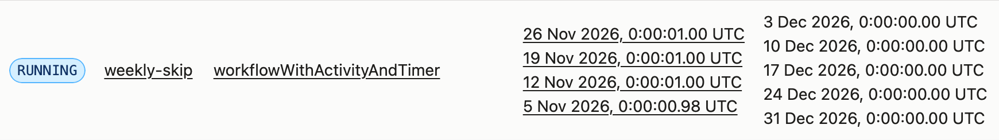

## Workflow and Schedules Prepared For Testing

Two example workflows are provided in the demo project written in TypeScript:

- **Workflow 1 — `workflowWithActivityAndTimer`** is a simple workflow with activities and user timers. Simply enabling time skipping allows it to advance through its timers and run to completion.
- **Workflow 2 — `workflowWaitOnSignalAndTimer`** represents a more complex Workflow that includes user timers, activities, and signals. It waits for a Signal with a timeout implemented as a user timer. We assume that the business flow requires the Signal to be sent only after the preceding user timers and Activities have completed.

These two Workflows are expected to be started by Schedules: 

- one weekly Schedule runs Workflow 1 with the **Skip** overlap policy
- and another weekly Schedule runs Workflow 2 with the **AllowAll** overlap policy.

## A Step-by-Step Guideline to Use Time Skipping

#### **Step1: get the pre-release CLI, start local server and worker**

All CLI examples below use `/tmp/temporal-ts`, the pre-release CLI binary from
the [v1.9.4-time-skipping pre-release](https://github.com/temporalio/cli/releases/tag/v1.9.4-time-skipping).
Use this path for both server and client commands.
This keeps your existing `temporal` command unchanged and requires no PATH setup.
`/tmp` is usually cleared on restart (macOS and most Linux distributions), so repeat this step after a reboot.

**Option A: download the prebuilt binary (no Go needed)**

```bash
# macOS on Apple silicon. For other platforms, replace darwin_arm64 with
# darwin_amd64, linux_amd64 or linux_arm64.
curl -fsSL -o /tmp/temporal-ts.tar.gz \
  https://github.com/temporalio/cli/releases/download/v1.9.4-time-skipping/temporal_cli_1.9.4-time-skipping_darwin_arm64.tar.gz
tar xzf /tmp/temporal-ts.tar.gz -C /tmp temporal
mv /tmp/temporal /tmp/temporal-ts
/tmp/temporal-ts --version
```

If you download the archive with a browser instead of `curl`, macOS Gatekeeper
blocks the binary. Clear the quarantine flag with
`xattr -d com.apple.quarantine /tmp/temporal-ts`.

On Windows, download the Windows asset from the release page and use the path to
`temporal.exe` in place of `/tmp/temporal-ts`.

**Option B: build from source (needs Go 1.27.3 or later)**

Download **Source code (zip)** or **Source code (tar.gz)** from the Assets section of
the pre-release and extract it. In the build command below, replace `/path/to/the/extracted-CLI-source`
with the extracted directory. With an older Go and the default `GOTOOLCHAIN=auto`,
Go downloads 1.27.3 automatically.

```bash
# build the pre-release CLI
cd /path/to/the/extracted-CLI-source
go build -o /tmp/temporal-ts ./cmd/temporal
```

**Start the local server and the Worker**

```bash
# start local server with time skipping
/tmp/temporal-ts server start-dev \
  --namespace timeskipping-test \
  --enable-time-skipping
```

Open **http://localhost:8233**, select the namespace of **timeskipping-test**, and leave the server
running. Its address is `127.0.0.1:7233`. If those ports are already in use, or CLI commands fail
with an `oauth2` error, see [Troubleshooting](#troubleshooting).

```bash
cd /path/to/demo-timeskipping-schedules
npm ci
npm run worker
```

#### **Step2: use time skipping on schedules (overlap-policy=skip) with workflow-1**

```bash
# create the weekly schedule and check upcoming runs in the UI

SCHEDULE_ID=weekly-skip

/tmp/temporal-ts schedule create \
  --namespace timeskipping-test \
  --schedule-id "$SCHEDULE_ID" \
  --interval 7d \
  --overlap-policy Skip \
  --workflow-id weekly-activity-month \
  --type workflowWithActivityAndTimer \
  --task-queue timeskipping-schedules
```

```bash
# fast-forward by 30days
/tmp/temporal-ts schedule time-skipping enable \
  --namespace timeskipping-test \
  --schedule-id "$SCHEDULE_ID" \
  --fast-forward-duration 30d \
  --fast-forward-id "${SCHEDULE_ID}-30d"
  
# check in UI
 
# optional: poll until time skipping completes
/tmp/temporal-ts schedule time-skipping poll \
  --namespace timeskipping-test \
  --schedule-id "$SCHEDULE_ID" \
  --fast-forward-id "${SCHEDULE_ID}-30d" \
  --command-timeout 30s
  
# optional: inspect time skipping status
/tmp/temporal-ts schedule describe \
  --namespace timeskipping-test \
  --schedule-id "$SCHEDULE_ID" \
  --time-format iso
```

Expected runs to be found in UI, workflows started by default also have time-skipping enabled and completes fast



#### **Step3: use time skipping on schedules (overlap-policy=allow-all) with workflow-2**

```bash
# fast-forward 15 days to start 2 workflows with a weekly schedule
# and disable time-skipping propagation 
# with "allow-all", the second workflow can be started with the first one still running

SCHEDULE_ID="weekly-allow-all"
SCHEDULE_FAST_FORWARD_ID="${SCHEDULE_ID}-15d"

/tmp/temporal-ts schedule create \
  --namespace timeskipping-test \
  --schedule-id "$SCHEDULE_ID" \
  --interval 7d \
  --overlap-policy AllowAll \
  --workflow-id weekly-approval \
  --type workflowWaitOnSignalAndTimer \
  --task-queue timeskipping-schedules

/tmp/temporal-ts schedule time-skipping enable \
  --namespace timeskipping-test \
  --schedule-id "$SCHEDULE_ID" \
  --fast-forward-duration 15d \
  --fast-forward-id "$SCHEDULE_FAST_FORWARD_ID" \
  --disable-propagation

# wait for the fast-forward to finish, so that both workflows have started
/tmp/temporal-ts schedule time-skipping poll \
  --namespace timeskipping-test \
  --schedule-id "$SCHEDULE_ID" \
  --fast-forward-id "$SCHEDULE_FAST_FORWARD_ID" \
  --command-timeout 30s

# list the running workflows; pick one of these IDs in the next block
/tmp/temporal-ts workflow list \
  --namespace timeskipping-test \
  --query "TemporalScheduledById = 'weekly-allow-all' AND ExecutionStatus = 'Running'"
```

How to use time skipping on workflows:

```bash
# If we don't want the signal to time out and send an approval just when 
# the workflow is waiting on the signal.

# set WORKFLOW_ID to one of the IDs listed above (your dates will differ), for example:
WORKFLOW_ID="weekly-approval-2026-11-05T00:00:00Z"

# 1) we skip the timer before the signal:
/tmp/temporal-ts workflow time-skipping enable \
  --namespace timeskipping-test \
  --workflow-id "$WORKFLOW_ID" \
  --fast-forward-duration 2h \
  --fast-forward-id "${WORKFLOW_ID}-before-signal"

# Optionally poll the fast-forward result
/tmp/temporal-ts workflow time-skipping poll \
  --namespace timeskipping-test \
  --workflow-id "$WORKFLOW_ID" \
  --fast-forward-id "${WORKFLOW_ID}-before-signal"

# 2) send an approve signal to the workflow
# Run this command from the same demo directory used to start the Worker.
cd /path/to/demo-timeskipping-schedules
npm run approve -- "$WORKFLOW_ID"

# 3) enable time skipping for the workflow to run to completion
/tmp/temporal-ts workflow time-skipping enable \
  --namespace timeskipping-test \
  --workflow-id "$WORKFLOW_ID"
  
# check the workflow in webUI to see the final result
# alternatively:
# if we don't do 1)2) and just perform 3) or just 
# use time skipping propagation from schedules, the signal will time out and 
# this workflow will end in a state that no one "approves" it.

```

## Schedule overlap policies and time skipping

- **AllowAll:** The Schedule can continue skipping time after starting a Workflow, without waiting for it to complete. A successful Schedule fast-forward poll does not mean that the Workflows it started have completed.
- **All other overlap policies, including Skip:** The Schedule waits for in-flight Workflows to complete before continuing to skip time.

## Troubleshooting

**Ports 7233 or 8233 are already in use** (for example, by another Temporal dev server).
Start this server on other ports, and point every later command at it with `TEMPORAL_ADDRESS`.
The CLI, the Worker and `npm run approve` all read it.

```bash
/tmp/temporal-ts server start-dev \
  --namespace timeskipping-test \
  --enable-time-skipping \
  --port 7243 --ui-port 8243 --metrics-port 8043

# run this in every terminal you use for the steps above; the UI is then at http://localhost:8243
export TEMPORAL_ADDRESS=127.0.0.1:7243
```

**CLI commands fail with `oauth2: "invalid_grant"`**, even against `127.0.0.1`.
If you once ran `temporal cloud login` without `--profile`, its OAuth token was saved in your
`default` CLI profile, and the CLI sends it to every server, including this local one.
Either run `temporal cloud logout`, or run this demo in a terminal where you first
`export TEMPORAL_CONFIG_FILE=/dev/null`.
